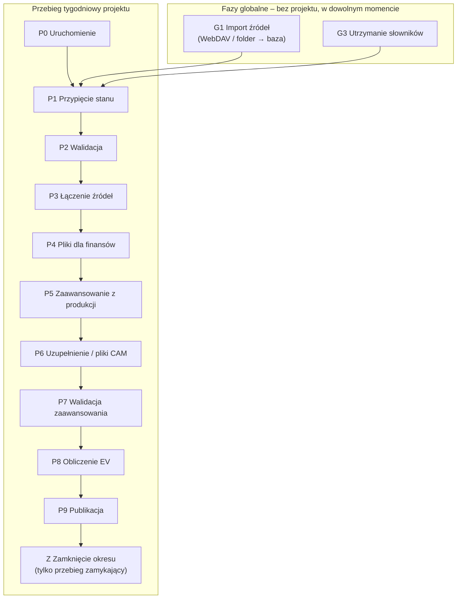

# PZL-EV – Przepływ: fazy i etapy

Zakres: jedyny opis przepływu – fazy globalne i etapy przebiegu tygodniowego: cel, wejście, bramki, działanie,
kontrole, efekt, przekazanie; statusy, kontrole jakości danych (problemy), współbieżność, zdarzenia w trakcie
przebiegu.

Powiązane: `docs/model-danych.md` (przebieg, znacznik stanu, rewizja), `docs/zrodla-danych.md` (źródła),
`docs/slowniki.md`, `docs/performance-objectives.md`, `docs/ev-obliczenia.md`, `docs/funkcjonalnosc.md` (ekrany).

---

## 1. Zasady wspólne

### 1.1 Kontrakt etapu

Każda faza i każdy etap mają ten sam kształt:

| Element | Znaczenie |
|---|---|
| **Wejście** | wyłącznie dane utrwalone w bazie: wyniki wcześniejszych etapów, importy, słowniki i nakładka Performance Objectives w stanie na znacznik stanu przebiegu – nigdy „z pamięci” poprzedniego kroku |
| **Bramka wejścia** | warunki, bez których etap nie ruszy |
| **Przetwarzanie** | dane – procedury i widoki bazy; obliczenie EV – silnik w aplikacji (`docs/architektura.md`, rozdz. 6) |
| **Wyjście** | tabele w bazie i ewentualne pliki; każdy rekord ma identyfikator pochodzenia (import, przebieg, rewizja) |
| **Bramka wyjścia** | kontrole, które muszą przejść, żeby następny etap mógł ruszyć |
| **Zapis stanu** | status etapu, kto, kiedy – `meta.EtapPrzebiegu` i dziennik |
| **Idempotencja** | ponowne wykonanie z tymi samymi wejściami daje ten sam wynik i nie dubluje danych |
| **Unieważnienie** | ponowne wykonanie etapu albo zmiana jego wejść oznacza etapy późniejsze jako **Nieaktualne** |
| **Uruchomienie** | użytkownik uruchamia przebieg; etapy wykonują się kolejno do najbliższej bramki (ERROR, WARNING przy bramce „Potwierdzenie”, zatwierdzenie ręczne) – dalej decyduje analityk (potwierdzenie z komentarzem, poprawa i ponowne wykonanie etapu); kolejność etapów i bramki – definicja przebiegu (rozdz. 4.1) |

Etapy komunikują się przez bazę, więc mogą je wykonywać różne osoby, w różne dni, z różnych komputerów.

### 1.2 Statusy etapu

| Status | Znaczenie | Przejścia |
|---|---|---|
| Oczekuje | poprzednie etapy niezakończone | → Do wykonania |
| Do wykonania | można uruchomić akcję etapu | → W toku |
| W toku | operacja trwa (blokada przebiegu) | → Zakończony / Wymaga akcji / Błąd |
| Wymaga akcji | potrzebna decyzja lub dane (potwierdzenie, pliki CAM, uzupełnienia, przypisania) | → Zakończony / Do wykonania |
| Błąd | kontrola z poziomem ERROR | → Do wykonania (po poprawie) |
| Zakończony | bramka wyjścia spełniona | → Nieaktualny (gdy zmienią się wejścia) |
| Nieaktualny | wynik oparty na nieaktualnych wejściach | → Do wykonania |

- Stan przebiegu wynika ze stanów etapów – pierwszy niezakończony etap wyznacza „co dalej”.
- Każda zmiana statusu trafia do dziennika (kto, kiedy, co).
- Wdrożone (przebieg etapowy, rozdz. 4.1): etapy uruchomienia w `META_RunStep` (migracja 050), wyniki kontroli z numerem etapu
  (`RUN_Issue.StepNo`). Po wykonaniu etapu: ERROR – **Błąd** (przebieg stoi; po poprawie – ponowne wykonanie etapu);
  zatwierdzenie ręczne albo WARNING przy bramce „Potwierdzenie” – **Wymaga akcji** (potwierdzenie z komentarzem → Zakończony,
  dalsze etapy); inaczej – **Zakończony** i następny etap. Ponowne wykonanie etapu oznacza późniejsze etapy jako Nieaktualne.
  Stan uruchomienia (`META_RunPin.Status`): w toku / wymaga akcji / zatrzymany – błąd / zakończony (z ostrzeżeniami). Logika –
  `Modules/Runs/Services/RunWorkflowEngine.cs`, wykonanie – `RunService` (Execute, Continue, Confirm, Rerun).

### 1.3 Problemy (kontrola jakości danych)

Kontrole importu zapisują wynik w tabeli problemów (`meta.Problem`); kontrole przebiegu (rozdz. 4.1) – w wynikach
uruchomienia przebiegu (`RUN_Issue`).

| Poziom | Znaczenie | Skutek |
|---|---|---|
| PASS | kontrola przeszła | widoczna w raporcie przebiegu |
| WARNING | ostrzeżenie | nie blokuje; widoczne w raporcie przebiegu i na pulpicie |
| ERROR | błąd blokujący | blokuje bramkę etapu do czasu poprawy |

- Problem zawiera: poziom, kontrolę, obszar (import, słownik, etap przebiegu), element, opis,
  akcję naprawczą (przejście do właściwego ekranu z filtrem na problem) i stan (otwarty / rozwiązany – kto, kiedy, jak).
- **Rozwiązanie problemu:** automatycznie, gdy przyczyna zniknęła – zakończony import zamyka problemy wcześniejszych
  importów (ocenia wszystkie pliki od nowa; przerwany niczego nie zamyka) – albo ręcznie: „Rozwiązane” na Pulpicie (wpis w dzienniku).
- Pulpit „Wymaga uwagi” pokazuje otwarte problemy wszystkich obszarów (błędy najpierw) i etapy wymagające akcji –
  użytkownik widzi, co wymaga działania, a nie techniczny stan etapów.
- Walidacja przy zapisie słowników używa tych samych poziomów, ale błędny zapis jest od razu odrzucany
  (`docs/slowniki.md`, rozdz. 1).

### 1.4 Współbieżność

- Jeden przebieg na projekt i tydzień (`docs/model-danych.md`, rozdz. 4.1).
- Operacja w toku zakłada blokadę – plik na dysku sieciowym (`00_Global\RABIT\<operacja>.lock`, opis kto i od kiedy
  w `<operacja>.lock.json`); system zwalnia go także po awarii aplikacji. Blokady importu i przebiegu:
  - `import` – pełny import (wszystkie źródła, ekran Import RABIT): jeden naraz, druga osoba widzi, kto importuje;
  - `import-file-…` – plik (lokalizacja + nazwa) na czas jego zapisu: pełny import i importy źródeł projektów
    pracują równolegle, plik zapisywany w innym imporcie jest pomijany („importuje go teraz inny import: …”);
  - `import-batch-<nr>` – trwający import (wpis „w toku” w historii importów). Import, którego blokada jest wolna
    (np. awaria aplikacji), dostaje przy następnym imporcie status „przerwany”, a jego pliki „w toku” są usuwane
    razem z wierszami `CAN_Row` i wracają do importu. Plik, którego wpis inny import usunął w trakcie zapisu, kończy się
    decyzją „błąd” (wróci przy kolejnym imporcie), nie „zaimportowany”;
  - `run-<Projekt>` – przebieg projektu: jeden naraz, druga osoba widzi, kto go liczy;
  - `run-pin-<nr>` – trwające uruchomienie przebiegu (przypięcie). Uruchomienie, którego blokada jest wolna, dostaje
    status „przerwany (brak zakończenia)”.

  Gdy blokady „żyje” (`import-batch-<nr>`, `run-pin-<nr>`) nie da się założyć, import albo przebieg nie startuje
  (wpis z powodem) – inaczej inna operacja uznałaby go za przerwany.
- Import jest idempotentny: ten sam hash pliku nie tworzy nowej wersji ani duplikatu danych.
- Zestawienie ACTUALS po Project definition (`CAN_ActualsBalance`, `docs/model-danych.md`, migracja 037) liczy import pliku
  w jednej transakcji ze zmianą stanu na „utworzone”, tylko pod swoim `FileId` – importy o dowolnej porze i równoległe
  nie kolidują, a odczyt projektu w trakcie importu widzi poprzednią wersję pliku albo nową, kompletną.
- Równoczesna edycja słowników – `docs/slowniki.md`, rozdz. 1.

---

## 2. Mapa faz

| Faza | Zasięg | Kto | Kiedy |
|---|---|---|---|
| G1 Import źródeł | globalna | Analityk | w dowolnym momencie; co najmniej tak często, jak RABIT nadpisuje pliki (O31) |
| G3 Utrzymanie słowników | globalna | Analityk | w dowolnym momencie |
| P0–P9, Z | projekt | Analityk prowadzący przebieg (może go przejąć inny Analityk) | co tydzień |

---

## 3. Fazy globalne

### G1. Import źródeł

| | |
|---|---|
| **Cel** | Zapisać w bazie każdą nową wersję raportu RABIT, zanim RABIT ją nadpisze. |
| **Wejście** | Wszystkie aktywne lokalizacje RABIT na SharePoint (WebDAV) oraz folder `00_Global\RABIT\Do_importu` z plikami pobranymi ręcznie (`docs/zrodla-danych.md`, rozdz. 3); definicje źródeł. |
| **Działanie** | 1) Plik o tych samych metadanych (lokalizacja, nazwa, rozmiar, data modyfikacji) co przy poprzednim imporcie jest pomijany bez czytania. 2) Rozpoznanie źródła po prefiksie nazwy. 3) Hash SHA-256 – ten sam hash oznacza duplikat. 4) Nowa treść: plik pobierany na dysk lokalny, potem jeden przebieg przez parser źródła – nowa wersja pliku z danymi kanonicznymi ładowanymi wsadowo do `can.Row`, z kontrolą liczby wierszy i sum w bazie; błąd wycofuje zapis. Status pliku na ekranie pokazuje etap (pobieranie, sprawdzanie, odczyt i zapis wierszy, kontrola w bazie) z postępem (`docs/zrodla-danych.md`, rozdz. 2). Każdy plik osobno; błąd jednego pliku albo jednej lokalizacji nie zatrzymuje pozostałych. |
| **Pochodzenie** | Każda wersja pliku i każdy wiersz: import (kto, kiedy), lokalizacja, hash, kod źródła, data raportu (data modyfikacji w RABIT). |
| **Kontrole** | `docs/zrodla-danych.md`, rozdz. 8. |
| **Efekt** | `meta.ImportBatch`, `meta.SourceFile`, `meta.SourceFileSeen`, `can.Row` (sam plik nie jest przechowywany); problemy importu. Historia importów widoczna dla wszystkich. |
| **Przekazanie** | P1 (dane projektu). |

Decyzja dla pliku:

| Decyzja | Znaczenie |
|---|---|
| zaimportowany | rozpoznany plik o nowej treści |
| pominięty | te same metadane co przy poprzednim imporcie – plik nie był czytany |
| duplikat | ten sam hash jest już w bazie (także pod inną nazwą) – komunikat podaje, kto i kiedy go zaimportował |
| nierozpoznany | brak pasującego prefiksu – plik nie jest importowany |
| błąd | np. uszkodzony plik albo przekroczony limit WebDAV |

### G3. Utrzymanie słowników

| | |
|---|---|
| **Cel** | Utrzymywać słowniki globalne i słowniki projektów. |
| **Działanie** | Edycja w aplikacji albo wczytanie z Excela – zasady i walidacja w `docs/slowniki.md`. |
| **Efekt** | Nowy stan słowników w historii. |
| **Przekazanie** | Przebieg czyta słowniki w stanie na swój znacznik stanu (P1); zmiana po przypięciu – rozdz. 5. |

---

## 4. Przebieg tygodniowy

Przebieg to przetworzenie jednego projektu za jeden tydzień (definicja i identyfikator – `docs/model-danych.md`,
rozdz. 4.1). Można go uruchomić w dowolnym dniu tygodnia. Wszystkie typy projektów przechodzą te same etapy;
typ wyznacza pobierane słowniki (`docs/slowniki.md`, rozdz. 4).

Kalendarz okresów wyznacza wariant przebiegu:

- **przebieg w środku okresu** – zaawansowanie z raportu produkcji, braki uzupełnia analityk; wynik: EV wstępne;
- **przebieg zamykający okres** – tydzień oznaczony w kalendarzu jako zamknięcie okresu; zaawansowanie podaje
  CAM, a wartość z raportu produkcji jest dla niego podpowiedzią; po zatwierdzeniu przebieg jest zamrażany;
  wynik: EV formalne.

| Etap | Krok na ekranie | W środku okresu | W przebiegu zamykającym | Bramka wyjścia |
|---|---|---|---|---|
| P0 Uruchomienie | Przygotowanie przebiegu | tak | tak | kontrole przed startem |
| P1 Przypięcie stanu | Przygotowanie przebiegu | tak | tak | zapisany znacznik stanu |
| P2 Walidacja | Walidacja | tak | tak | brak ERROR |
| P3 Łączenie źródeł | Uzgodnienie | tak | tak | suma kontrolna; elementy bez przypisania przypisane albo świadomie pominięte |
| P4 Pliki dla finansów | Przegląd finansów | tak | tak | potwierdzenie |
| P5 Zaawansowanie z produkcji | Zaawansowanie | tak | tak – jako podpowiedź | zaawansowanie pobrane |
| P6 Uzupełnienie zaawansowania | Zaawansowanie | uzupełnienie braków przez analityka | pliki CAM | braki uzupełnione / pliki wszystkich CAM zaimportowane |
| P7 Walidacja zaawansowania | Zaawansowanie | tak | tak + 100% wartości od CAM | brak ERROR |
| P8 Obliczenie EV | Obliczenie i przegląd | tak | tak | rewizja zapisana |
| P9 Publikacja | Publikacja | tak | tak | pliki zapisane |
| Z Zamknięcie okresu | Zamrożenie | – | tak | zatwierdzenie |

### 4.1 Kontrole danych przebiegu (wdrożone: P0, P1, kontrole ACTUALS, spójność ze słownikami – P2)

„Uruchom przebieg” (ekran projektu) wykonuje w tle: tydzień z kalendarza okresów i przebieg `R-<Projekt>-<RRRR-MM>-T<NN>`
(kolejne uruchomienie w tym tygodniu – nowe przypięcie, numer #N) → import źródeł projektu (słownik „Źródła danych”,
`docs/zrodla-danych.md`, rozdz. 2) → przypięcie: dane ACTUALS projektu z ostatniego importu (`RUN_PinBalance` w jednej
transakcji, `docs/model-danych.md`, migracja 027) → kontrole wobec ostatniego zakończonego uruchomienia wcześniejszego tygodnia.
Kwoty – pole kwoty ACTUALS projektu (słownik „Parametry projektu”, domyślnie waluta obiektu – PLN, `Value in Obj. Crcy`);
pole inne niż w poprzednim przebiegu – WARNING i reguły bez porównania z poprzednim przebiegiem (`@JestPoprzedni = 0`).
Przypięcie zapisuje też dane jak w strukturze programu (`RUN_BalanceEv` – tabela `ev` reguł): bez rozliczeniowych, po Wykluczeniach,
rodzaj kosztu z Cost Category; projekt CAS: przypięcie zawsze z PLN (`Value in Obj. Crcy`), `ev` – koszty po narzutach CAS w walucie
projektu (kurs CAS, `docs/slowniki.md`, rozdz. 6.1; koszt brutto przebiegu = ACWP struktury); netowanie projektu do 0 i saldo okresów
zamkniętych – na danych źródłowych (`biezace`, rozliczenie nie dostaje narzutów); brak kursu CAS – ERROR „Koszty po narzutach CAS”
i `ev` bez narzutów. Etap walidacji odświeża `ev` przed regułami (słowniki i Wykluczenia mogły się zmienić – „Wykonaj ponownie”). Okresy zamknięte – okresy SAP przed
bieżącym okresem kalendarza, a w pierwszych 7 dniach okresu – przed poprzednim (rozliczenie poprzedniego okresu trwa);
okresy 13–16 liczone jak 12.

**Definicja przebiegu (workflow).** Co dzieje się na którym etapie, określa szablon przebiegu – ekran Przebiegi (menu): w jednej
kolumnie lista szablonów (startowe: „Wewnętrzny” – domyślny dla wszystkich typów, w tym SAC; „CAS” – domyślny dla CAS; „Utwórz
szablony startowe”) i lista reguł walidacji (bez osobnego okna i zakładek). Etapy szablonu w kafelkach: klocki predefiniowane
**Import źródeł** i **Przypięcie stanu** korzystają z konfiguracji programu (Źródła danych, Parametry programu) – zawsze etapy 1 i 2,
bez zmian i przesuwania. Dalej etapy dokładane w edytorze: **etap walidacji** (tylko zaznaczanie reguł walidacji – lista z poziomem
i użytymi tabelami, szukaj po nazwie albo tabeli; treść i poziom reguły – edytor reguł; bramka WARNING: „Potwierdzenie” – wstrzymuje
do potwierdzenia z komentarzem, „Informacja” – przebieg idzie dalej; opcjonalnie zatwierdzenie po etapie) i **zatwierdzenie**
(przebieg czeka na analityka). Zapis sprawdza strukturę (`RunDefinitions.Validate`: etapy stałe na początku, nazwy etapów bez
powtórzeń, etap walidacji z regułą, reguły istniejące w regułach walidacji) i zapisuje szablon w słownikach globalnych „Definicje
przebiegów”, „Etapy przebiegów”, „Elementy kontrolne etapów” (historia; `docs/slowniki.md`, rozdz. 2;
`Modules/Runs/Services/RunTemplateService.cs`). Szablonu wybranego w programach nie można usunąć.

Program wybiera przebieg w kreatorze (krok 1) albo w Konfiguracji → „Parametry programu” → `Przebieg`. Wybór definicji przy starcie
przebiegu (`RunDefinitions.For`): wybrany szablon (aktywny, z etapami); bez wyboru (albo wybrany nieaktywny) – aktywny szablon
domyślny dla typu programu (typ przed „Wszystkie”); bez szablonów – **definicja wbudowana** „Standardowy (wbudowany)”: 1 Import
źródeł → 2 Przypięcie stanu → 3 Walidacja ACTUALS (13 reguł startowych ACTUALS) → 4 Walidacja EV (8 reguł startowych EV) →
5 Zatwierdzenie analityka (etapy walidacji z bramką „Potwierdzenie”; szablony startowe mają te same etapy). Przebieg zamykający okres
i w środku okresu mają tę samą definicję – wariant to informacja dla analityka (dziennik, ekran programu). Definicja (z etapami
i regułami etapów) zapisuje się w uruchomieniu (`META_RunPin.Definition`, JSON) – zmiana szablonu nie zmienia trwającego przebiegu;
treść reguły – z bieżącego słownika w chwili wykonania etapu. Model – `Shared/Models/Pipeline/RunWorkflow.cs`.

Przebieg prowadzi się na poziomie programu: ekran programu, zakładka „Przebieg” – przebieg programu (wybrany / domyślny), etapy
uruchomienia ze statusem, wyniki etapu, akcje „Nowy przebieg”, „Dalsze etapy”, „Potwierdź i dalej” (komentarz wymagany),
„Wykonaj ponownie”; porównania: macierz reguł, porównanie dwóch uruchomień, okno „Zmiany ACWP” (`docs/funkcjonalnosc.md`, F06).
Kolejne akcje etapów (np. kafelek warunkowy „jeśli przebieg zamykający – powiadomienie CAM o uzupełnieniu danych do ETC” – P6) –
nowe akcje w `RunActions` i ich wykonanie w `RunService.ExecuteStep`.

**Reguły walidacji w SQL** (F5.7, `tasks/F5.7-reguly-walidacji-sql.md`). Każda kontrola danych przebiegu to reguła w słowniku globalnym
„Reguły walidacji” (`docs/slowniki.md`, rozdz. 2; migracja 051): **Nazwa** (wiersz macierzy wyników), **Opis** (dla analityka),
**Poziom** (ERROR / WARNING / INFO), **Aktywna**, **Zapytanie SQL** (MS SQL) i opcjonalny **Opis wyniku**. Zapytanie zwraca tylko
dane: **każdy zwrócony wiersz to jedna nieprawidłowość** z poziomem reguły, kolumny dowolne; brak wierszy – reguła spełniona (INFO
„OK”). Sortowanie, grupowanie i limity – w SQL (`ORDER BY`, `GROUP BY`, `TOP`); progi, grupy wyników („Kontrola”), „Najwyżej”,
komunikat OK i poziom na kafelku szablonu – nie istnieją. Opis wyniku: tekst z nazwami kolumn w `{ }`, np.
`{ElementWBS}: saldo {Saldo}` (liczby dziesiętne – format polski z 2 miejscami, całkowite – bez separatora, daty – RRRR-MM-DD,
NULL – „(brak)”); puste – „Kolumna: wartość; …”. Element wyniku – pierwsza niepusta kolumna `ElementWBS`, `CostElement`,
`RodzajKosztu`, `WP`, `MPK`. Model, reguły startowe, kontrola zapytania – `Shared/Models/Pipeline/RunRules*.cs`; wykonanie –
`SqlRunStore.RunRule`, wyniki – `RunService.Issues`.

Dane dostępne w zapytaniu – tabele (CTE) i parametry, które aplikacja podstawia dla uruchomienia programu:

| Tabela / parametr | Zawartość |
|---|---|
| `biezace` | ACTUALS przypięte w uruchomieniu – cała pula (także rozliczeniowe), przed narzutami, bez Wykluczeń: `ElementWBS` (NULL – sieci, zlecenia), `CostElement`, `Rok`, `Okres`, `RokOkres` (tekst „RRRR/OO”, okresy 13–16 jak 12), `OkresyWstecz` (0 – bieżący okres, 1 – poprzedni …, ujemne – przyszłe), `Rozliczeniowy` (0/1), `Waluta`, `Wiersze` (liczba wierszy źródłowych), `Kwota`, `Utworzono`, `OkresZamkniety`, `OkresPrzyszly` (0/1) |
| `poprzednie` | to samo z poprzedniego przebiegu – ostatnie uruchomienie wcześniejszego tygodnia z tym samym polem kwoty (pusta, gdy brak) |
| `ev` | dane jak w strukturze (`RUN_BalanceEv`): bez rozliczeniowych, po Wykluczeniach (bez partnera – partnera nie ma w danych przypiętych), CAS po narzutach: `ElementWBS`, `CostElement`, `Rok`, `Okres`, `RokOkres`, `OkresyWstecz`, `OkresZamkniety`, `RodzajKosztu` (Hours / Materials / Other), `Kwota` |
| `ev_poprzednie` | to samo z poprzedniego przebiegu (uruchomienie sprzed reguł SQL – zapisywane przy pierwszej potrzebie) |
| `cost_category` | Cost Category programu (wiersz programu przed globalnym): `CostElement`, `Opis`, `CostCategory` (NULL – pusta), `RodzajKosztu`, `Rozliczeniowy` |
| `wp_cam`, `stawki`, `harmonogram` | `ElementP1S, WP, CAM, MPK` · `MPK, Rok, LaborRate` (globalne) · `WP, BAC, BacHours, BacMaterial, Waluta` |
| parametry | `@BiezacyOkres`, `@PierwszyOtwartyOkres` („RRRR/OO”; wcześniejsze okresy – zamknięte), `@JestPoprzedni` (1/0), `@WalutaKosztow` (PLN dla pola w walucie obiektu, inaczej przeważająca w danych), `@TypProgramu`, `@Program` |

Zapytanie zaczynające się od `WITH` dołącza swoje CTE do tabel uruchomienia. **Bezpieczeństwo** (O52 rozstrzygnięte – wystarczy blokada
w aplikacji, bez osobnego loginu tylko do odczytu): tylko jedno zapytanie `SELECT` albo `WITH … SELECT`, bez średnika i bez słów `INSERT`, `UPDATE`,
`DELETE`, `MERGE`, `EXEC`, `DROP`, `ALTER`, `CREATE`, `TRUNCATE`, `GRANT`, `REVOKE`, `DENY`, `INTO`, `OPENROWSET`/`OPENQUERY`, poleceń
transakcji i sesji (`BEGIN`, `COMMIT`, `ROLLBACK`, `SET`, `DECLARE`, `USE` …) oraz procedur `sp_` / `xp_` (poza tekstami w apostrofach,
nazwami w nawiasach i komentarzami) – kontrola przy zapisie (słownik) i przed wykonaniem; transakcja zawsze wycofywana; limit czasu
30 s, najwyżej 500 wierszy (więcej – WARNING „wynik obcięty”). Błąd zapytania w przebiegu – ERROR „Reguła niepoliczona” z treścią
błędu SQL Server (linia w zapytaniu reguły); reguła z szablonu, której nie ma w słowniku – WARNING „niesprawdzona”.

**Edytor reguł** (ekran Przebiegi, lista reguł pod szablonami): nazwa, poziom, aktywna, opis, pole SQL z listą tabel i kolumn obok,
opis wyniku; „+ Nowa”, „Kopiuj”, „Usuń” (reguły zaznaczonej w szablonach nie można usunąć), „Odrzuć zmiany”, „Zapisz regułę” (cały
słownik z historią; pusty słownik – reguły startowe aplikacji, pierwszy zapis tworzy wszystkie wiersze). **Testuj na programie** –
reguła (także niezapisana) na ostatnim uruchomieniu wybranego programu z przypiętymi danymi i poprzednim jak w przebiegu (okresy z dnia
uruchomienia), bez zapisu wyników: tabela kolumn zwróconych przez SQL i opis wyniku; błąd SQL Server z numerem linii; nieznane kolumny
w opisie wyniku.

Reguły startowe (migracja 052 zapisuje je do słownika razem z szablonami „Wewnętrzny” i „CAS”; bez niej obowiązują, dopóki słownik jest pusty; te same nieprawidłowości co dawne reguły z formułami i reguły wbudowane – testy
na bazie `RunRulesSqlTests`):

| Reguła | Poziom | Dane | Logika |
|---|---|---|---|
| Mniej wierszy niż w poprzednim przebiegu | ERROR | biezace, poprzednie | suma `Wiersze` mniejsza niż w poprzednim (zrzut narastający) |
| Koszt brutto mniejszy niż w poprzednim przebiegu | WARNING | biezace, poprzednie | koszt bez rozliczeniowych mniejszy o więcej niż 1 |
| Największe odchylenia raport do raportu (– cost element) | INFO | biezace, poprzednie | 10 elementów WBS (cost elementów) z największą zmianą salda, \|zmiana\| ≥ 1 |
| Cost element spoza słownika Cost Category | ERROR | biezace, cost_category | cost element bez wpisu w Cost Category programu |
| Cost element pierwszy raz w programie | INFO | biezace, poprzednie, cost_category | cost element ze słownika, którego w poprzednim przebiegu nie było |
| Netowanie do 0 w okresach zamkniętych | ERROR | biezace | saldo programu w okresach zamkniętych > 1: 10 elementów WBS z saldem – koszt, rozliczenie, przyczyna, ostatni okres z ruchem, saldo programu |
| Koszt utworzony po rozliczeniu | WARNING | biezace | program nie netuje się do 0: koszt utworzony później niż rozliczenie elementu w okresie |
| Zmiana salda okresu zamkniętego | WARNING | biezace, poprzednie | saldo elementu WBS w okresie zamkniętym zmienione o więcej niż 1 |
| Ujemny koszt elementu WBS | WARNING | biezace | saldo narastająco < −1 (koszt i rozliczenie) |
| Wiersze w okresach przyszłych / Waluta inna niż waluta kosztów / Wiersze bez elementu WBS | WARNING | biezace | jak nazwa (waluta – `@WalutaKosztow`) |
| Cost element bez Cost Category | WARNING | ev, cost_category | cost element kosztu z pustą Cost Category |
| MPK bez stawki wydziału na rok | ERROR | wp_cam, stawki | MPK WP bez stawki na rok bieżącego okresu, lista WP |
| WP bez MPK / WP bez budżetu | WARNING | wp_cam, harmonogram | WP bez MPK; WP bez BAC, BAC HOURS i BAC MATERIAL |
| Nowy rodzaj kosztu w programie | WARNING | ev, ev_poprzednie | rodzaj z kosztem (\|kwota\| > 1), którego w poprzednim przebiegu nie było |
| Skok przyrostu kosztu | WARNING | ev | przyrost rodzaju w bieżącym okresie > 3 × średni przyrost z 6 okresów przed bieżącym |
| Spadek kosztu narastająco w rodzaju / Zmiana rodzaju kosztu w zamkniętych okresach | WARNING | ev, ev_poprzednie | koszt rodzaju narastająco / w okresach zamkniętych zmieniony o więcej niż 1 |
| Koszt brutto nie większy niż BAC × 1,1 | WARNING | ev, harmonogram | przykład uzgodnienia (zamiast reguł uzgodnień z miarami) – poza szablonami startowymi |

Wyniki w programie (zakładka Przebieg, O53 – bez wykresów i porównań okresów; wynik zapytania i problemy):
- wyniki etapu po regułach – poziom (ERROR / WARNING / INFO / OK), nazwa, liczba problemów; najpierw najgorsze;
- wybrana reguła – **kontekst sprawdzenia**: co sprawdza (opis reguły), dane (tabele użyte w zapytaniu z opisem), zakres uruchomienia
  (bieżący okres, okresy zamknięte, poprzedni przebieg do porównania);
- **wynik zapytania**: kolumny zwrócone przez SQL (`RUN_Issue.Details`, JSON), na początku Nr, Poziom, **Problem** i **Wskazówka** –
  kolumny wyniku `Problem` i `Wskazowka`, a bez nich opis wyniku (np. netowanie: „rozliczenie niepełne” / „rozliczenie większe niż
  koszt” / „brak rozliczenia” ze wskazówką);
- **linie ACTUALS** zaznaczonego wiersza – zakres z kolumn wiersza: `ElementWBS`, `CostElement` albo `RodzajKosztu` (cost elementy
  rodzaju w danych przypiętych), okres – `RokOkres` albo `Okres` „RRRR/OO”, albo `Rok` i `Okres` (okres 12 obejmuje 13–16); bez elementu
  WBS – elementy WBS programu z danych przypiętych; najnowsze wersje plików zaimportowane do końca przypięcia; 500 największych wg
  |kwoty| (liczba i suma wszystkich): okres, element WBS, cost element, Created on, opis, partner, zamówienie, faktura, zlecenie, ilość,
  kwota, plik i wiersz (`SqlRunStore.ActualsLines`, `RunOverview.ActualsScope`); wiersz bez tych kolumn – bez linii;
- **Wynik do Excela** – wynik reguły i wszystkie linie ACTUALS zaznaczonego wiersza; „Pokaż zmiany” – okno „Zmiany ACWP” dla wiersza
  (kolumna `ElementWBS`, `RodzajKosztu` albo `CostElement` – dla tej wartości, inaczej cały program).

Zakładki porównań: macierz reguła × uruchomienia (wiersz – nazwa reguły; „n ERROR”, „n WARNING”, „n INFO”, „OK”) i porównanie dwóch
uruchomień – wiersze wyników tej samej reguły dopasowane po wartościach kolumn tekstowych, różnice w kolumnach liczbowych; nowe,
zmienione, rozwiązane.

Wynik: stan uruchomienia („zakończony”, „zakończony z ostrzeżeniami”, „zakończony z błędami”, „przerwany błędem”;
uruchomienie bez działającej aplikacji – „przerwany (brak zakończenia)”), wyniki kontroli, dziennik, powiadomienia
(`docs/funkcjonalnosc.md`, F06). Linie statystyczne (niewidoczne w zrzucie ACTUALS – brak
typu wartości) nie są rozliczane: projekt z nimi nie netuje się do 0, a kontrola pokazuje saldo i jego wartość.
Kontrole wymagające innych danych spoza zrzutu (odbiorca rozliczenia, suma kontrolna z SAP) – O50.

### P0. Uruchomienie

| | |
|---|---|
| **Cel** | Założyć przebieg projektu za tydzień. |
| **Działanie** | Wybór tygodnia (domyślnie bieżący; dziś zawsze tydzień bieżący z kalendarza okresów – wybór niewdrożony). Aplikacja pokazuje okres i to, czy przebieg zamyka okres (kalendarz okresów), oraz datę stanu (`docs/ev-obliczenia.md`, rozdz. 2). |
| **Bramka wejścia** | tydzień jest w kalendarzu okresów (ERROR); przebieg projektu nie jest właśnie liczony (blokada `run-<Projekt>`, rozdz. 1.4) – kolejne uruchomienie w tym samym tygodniu to nowe przypięcie #N tego samego przebiegu (rozdz. 4.1); projekt gotowy – wymagane słowniki projektu dla typu (`docs/funkcjonalnosc.md`, F02) – sprawdza ekran projektu („Uruchom przebieg” aktywne tylko dla projektu gotowego; sama usługa przebiegu gotowości nie sprawdza); zgodna wersja aplikacji – kontrola przy starcie aplikacji (`docs/architektura.md`, rozdz. 3); świeżość danych produkcyjnych – data odświeżenia `vAHDD` (WARNING – niewdrożone). |
| **Efekt** | Przebieg `R-<Projekt>-<RRRR-MM>-T<NN>`, pierwsze zdarzenie w dzienniku. |
| **Przekazanie** | P1. |

### P1. Przypięcie stanu

| | |
|---|---|
| **Cel** | Ustalić, na jakich danych liczy przebieg. |
| **Działanie** | Aplikacja pokazuje, co zmieniło się od poprzedniego przebiegu projektu: nowe wersje plików i datę ostatniego importu, zmiany słowników (kto, kiedy). **Przypnij** zapisuje znacznik stanu (`docs/model-danych.md`, rozdz. 4.2). Procedury wybierają dane projektu: wiersze elementów z zakresu projektu (nakładka Performance Objectives – `docs/performance-objectives.md`) w okresie przebiegu (koszt okresu i narastająco – O30). Sposób przypisania kosztów i zaawansowania do węzłów nakładki – O45. |
| **Kontrole** | pliki nierozpoznane od ostatniego importu (WARNING); ostatni import starszy niż próg świeżości (O29; WARNING). |
| **Efekt** | Znacznik stanu w przebiegu; zestawienie danych projektu (liczba wierszy, koszt). |
| **Przekazanie** | P2–P9 pracują wyłącznie na stanie ze znacznika. |

### P2. Walidacja

| | |
|---|---|
| **Cel** | Nie dopuścić niespójnych danych i słowników do obliczeń. |
| **Działanie** | Poprawność samych słowników zapewnia walidacja przy zapisie (`docs/slowniki.md`, rozdz. 5), a plików – import (`docs/zrodla-danych.md`, rozdz. 8). Tu: spójność danych projektu ze słownikami i okresem. |
| **Wdrożone** | kontrole spójności ze słownikami w przebiegu (rozdz. 4.1): cost element spoza Cost Category (ERROR), cost element bez kategorii (WARNING), MPK WP bez stawki na rok (ERROR), WP bez MPK (WARNING), WP bez budżetu (WARNING). Niewdrożone: daty księgowania względem okresu – zrzut ACTUALS nie ma daty księgowania (tylko `Created on`, które po rozliczeniu legalnie jest późniejsze; kontrola okresów przyszłych – rozdz. 4.1) i znaczenie okresu nie jest polem definicji źródła (`docs/zrodla-danych.md`, rozdz. 2); duplikaty między częściami źródła – klucz wiersza ACTUALS nieustalony (O27, O50). Programy CAS: koszt po narzutach CAS (słowniki globalne, O37 rozstrzygnięte) – ETC Cost liczy ta sama stawka MPK, więc kontrola MPK obowiązuje także w CAS (wyłączenie – reguła „MPK bez stawki wydziału na rok” w edytorze reguł albo w szablonie). |
| **Kontrole** | MPK z kosztów bez stawki na dany rok – stawki wydziałów (klucz MPK + rok) albo, w CAS, stawki CAS (ERROR); numer elementu kosztowego bez wpisu w efektywnym słowniku Cost Category (ERROR – O25; naprawa: pozycja w słowniku projektu); numer bez kategorii (WARNING); WP bez budżetu (WARNING); daty księgowania niezgodne z okresem przebiegu według znaczenia okresu w definicji źródła (ERROR); duplikaty wierszy między częściami źródła (ERROR). |
| **Przy ERROR** | **Popraw w aplikacji** (ekran Słowniki z filtrem na problem) → **Przypnij ponownie** (P1) i waliduj. |
| **Efekt** | Problemy przebiegu; WARNING trafiają do raportu przebiegu. |
| **Przekazanie** | P3 rusza tylko bez ERROR. |

### P3. Łączenie źródeł

| | |
|---|---|
| **Cel** | Jeden spójny obraz kosztów projektu: koszt rzeczywisty (ACWP) przypisany do WP, CAM i kategorii kosztów, w walucie wyniku. |
| **Działanie** | Procedury w bazie (logika – O14): element CES → węzeł nakładki Performance Objectives → element P1S (`Legacy WBS` węzła i elementy `LOG.WBS` pod nim – `docs/performance-objectives.md`, rozdz. 4.1) → WP (słownik „WP i CAM”); przeliczenie godzin na koszt według stawek wydziałów (MPK + rok) albo stawek CAS (typ projektu); przeliczenie waluty według kursów. Podsumowanie: koszt okresu, liczba elementów przypisanych do WP, liczba WP, suma kontrolna. |
| **Kontrole** | suma kontrolna: koszt po połączeniu = koszt danych projektu (ERROR). **Elementy bez przypisania:** element CES z kosztem spoza nakładki projektu, element z zaawansowaniem bez WP – WARNING w środku okresu, ERROR w przebiegu zamykającym (O33). |
| **Akcje** | **Przypisz** – nakładka Performance Objectives (element CES, `Legacy WBS`) albo słownik „WP i CAM” → przypnij ponownie (P1). **Kontynuuj bez tych elementów** – tylko w środku okresu; decyzja w dzienniku, wartość poza EV pokazana w raporcie przebiegu. |
| **Efekt** | `ev.KosztWP` (przebieg, WP, okres, kwoty, pochodzenie) i raport pokrycia. |
| **Przekazanie** | P4; P8 (ACWP). |

### P4. Pliki dla finansów

| | |
|---|---|
| **Cel** | Dać finansom do sprawdzenia wynik łączenia, zanim zostanie użyty dalej. |
| **Działanie** | Generuje pliki do `Projekty\<Projekt>\Finanse\<RRRR-MM>\` (`docs/funkcjonalnosc.md`, rozdz. 4; zawartość – O16) i czeka na decyzję: **Potwierdź** (może osoba prowadząca przebieg; zapis kto i kiedy) albo **Odrzuć** (wymagany komentarz). |
| **Przekazanie** | Potwierdzenie odblokowuje P5; odrzucenie cofa do P3 (P4 i dalsze – Nieaktualne). |

### P5. Zaawansowanie z produkcji

| | |
|---|---|
| **Cel** | Pobrać zaawansowanie godzin i materiałów z produkcji dla WP projektu. |
| **Działanie** | Odczyt zaawansowania (`docs/zrodla-danych.md`, rozdz. 6) dla elementów P1S projektu i przypisanie do WP; zapis w `ev.Zaawansowanie` z pochodzeniem `PRODUKCJA`. Wynik: liczba WP z wartością, lista WP bez wartości. W przebiegu zamykającym wartość jest podpowiedzią dla CAM (P6). |
| **Przekazanie** | P6. |

### P6. Uzupełnienie zaawansowania

| | W środku okresu | W przebiegu zamykającym |
|---|---|---|
| **Działanie** | Tabela WP bez wartości (WP, CAM, ostatnia znana wartość, metoda, wartość). Metody: ostatnia znana wartość, wartość ręczna (zasady – O11). Zapis z pochodzeniem `ANALITYK`, kto, kiedy, metoda. | **Generuj pliki dla CAM** – jeden plik na CAM do `CAM\<RRRR-MM>\Wyslane\`, z wartością z produkcji jako podpowiedzią (format – `docs/zrodla-danych.md`, rozdz. 7). **Skanuj folder Zwrócone** – status per CAM: wysłany / zwrócony / zaimportowany / odrzucony (z powodem). Etap czeka (dni), aż pliki wszystkich CAM zostaną zaimportowane. Pochodzenie `CAM`. |
| **Bramka wyjścia** | braki uzupełnione | pliki wszystkich CAM zaimportowane (O34) |

- Każda zmiana wartości to nowy wpis z pochodzeniem – wpis ręczny nie nadpisuje wartości bez śladu.
- Ponowne wykonanie etapu wykorzystuje wartości już zapisane w przebiegu (np. zaimportowane pliki CAM);
  zmienia je tylko nowa akcja użytkownika.

### P7. Walidacja zaawansowania

| | |
|---|---|
| **Działanie** | Udział wartości według pochodzenia (wykres paskowy) i kontrole. |
| **Kontrole** | wartość w zakresie 0–100% (ERROR); spadek względem poprzedniego okresu (WARNING); w przebiegu zamykającym – 100% wartości od CAM (ERROR). |
| **Przekazanie** | P8 rusza tylko bez ERROR. |

### P8. Obliczenie EV

| | |
|---|---|
| **Cel** | Policzyć wskaźniki EV projektu w sposób odtwarzalny. |
| **Działanie** | Silnik EVM (`docs/ev-obliczenia.md`) liczy wskaźniki na poziomach WP, CAM, `PROJORG` i projektu; wynik zapisywany jako rewizja (`docs/model-danych.md`, rozdz. 4.3). Przegląd wyniku w aplikacji. **Przelicz ponownie** tworzy nową rewizję – poprzednie zostają. |
| **Kontrole** | `docs/ev-obliczenia.md`, rozdz. 5. |
| **Efekt** | Rewizja R*n* w `ev.Wynik`. |
| **Przekazanie** | P9. |

### P9. Publikacja

| | |
|---|---|
| **Działanie** | Plik wyniku EV do `EV\<RRRR-MM>\`; w projektach SAC plik dla Cobra (koszt pracy przeliczony po bieżących stawkach na USD, zaawansowanie według WP); wynik dostępny w widokach dla BI. Nazwy plików – `docs/funkcjonalnosc.md`, rozdz. 4. |
| **Przekazanie** | W środku okresu – koniec przebiegu. W przebiegu zamykającym – Z. |

### Z. Zamknięcie okresu

| | |
|---|---|
| **Bramka wejścia** | Przebieg zamykający; etapy P0–P9 zakończone. |
| **Działanie** | **Zatwierdź zamknięcie okresu** – wskazana rewizja staje się formalnym wynikiem okresu; przebieg zostaje zamrożony (tylko do odczytu). |
| **Efekt** | Zamrożony wynik okresu – podstawa raportów i porównań kolejnych okresów. |

---

## 5. Zdarzenia w trakcie przebiegu

| Zdarzenie | Zachowanie |
|---|---|
| **Zmiana po przypięciu** – nowe wersje plików, zmiany słowników | Baner w przebiegu: co się zmieniło, kto, kiedy, liczba zmian. **Kontynuuj na przypiętym stanie** – decyzja w dzienniku, baner znika dla tych zmian. **Przypnij ponownie** – nowy znacznik stanu (P1); etapy od P2 – Nieaktualne. |
| **Kontynuacja przez inną osobę** | Każdy Analityk może wykonać dowolną akcję w dowolnym przebiegu. Ekran przebiegu pokazuje, kto ostatnio pracował; każda akcja jest w dzienniku z kontem AD. |

Zamrożonego przebiegu zmiany nie dotyczą.

---

## 6. Co przepływa między fazami

| Z → Do | Nośnik | Identyfikator łączący |
|---|---|---|
| G1 → P1 | wersje plików, dane kanoniczne | hash SHA-256, import, kod źródła |
| G3 → P1 | słowniki | znacznik stanu |
| P1 → P2–P9 | znacznik stanu, dane projektu | przebieg, znacznik stanu |
| P2 → P3 | problemy | przebieg |
| P3 → P4, P8 | `ev.KosztWP` | przebieg |
| P4 → P5 | potwierdzenie | przebieg |
| P5, P6 → P7 → P8 | `ev.Zaawansowanie` | przebieg, pochodzenie |
| P8 → P9, Z | `ev.Wynik` | przebieg, rewizja |

---

## 7. Otwarte kwestie

| # | Kwestia |
|---|---|
| O11 | Zasady uzupełniania braków zaawansowania w środku okresu (metody, metoda domyślna) |
| O14 | Logika łączenia źródeł (P3) – do przedstawienia przez zespół |
| O29 | Próg świeżości importu przed przypięciem (ile dni od ostatniego importu) |
| O31 | Harmonogram importu względem harmonogramu RABIT (RABIT nadpisuje pliki – wersja pośrednia bez importu przepada); import uruchamiany harmonogramem zadań Windows? |
| O33 | Element CES z kosztem bez przypisania (spoza nakładki albo bez WP) w przebiegu zamykającym: czy dopuścić zamknięcie, czy wymagać przypisania (ERROR – P3)? Rekomendacja: wymagać przypisania |
| O34 | CAM nie odesłał pliku w przebiegu zamykającym: blokada etapu (dziś) czy przyjęcie wartości z produkcji z oznaczeniem pochodzenia? |
| O50 | Kontrole przebiegu wymagające kolumn spoza zrzutu ACTUALS: numer dokumentu CO i pozycja (stały klucz porównania przebiegów), odbiorca rozliczenia (PA, centrum kosztów, środek trwały w budowie), suma kontrolna projektu i okresu z niezależnego raportu SAP |
